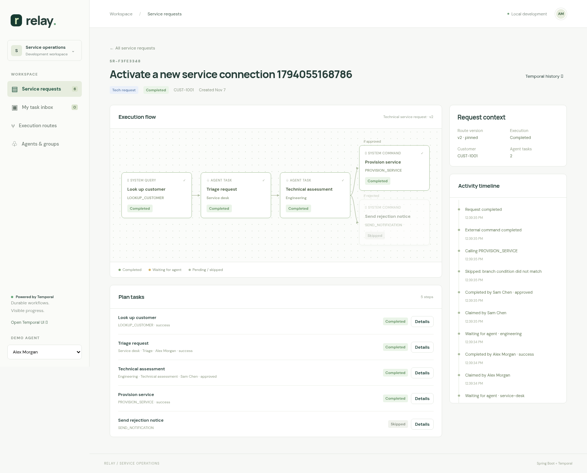

# Temporal service-request processing

A working **Java 21 + Spring Boot + Temporal** example with a browser UI. A service request owns a versioned execution plan with two distinct classes of work:

- **Internal tasks** are processed by your agents. Eligibility requires membership in the assigned group **and** support for the task's type. Agents claim work and submit an outcome; compatible groups can receive reassigned work.
- **External tasks** query another system or send it a command. These run as HTTP-backed Temporal activities with timeouts and retries. Commands carry stable idempotency keys.

Request types include `TECH_REQUEST`, `CLAIM`, and `CUSTOM`; routes can introduce other request-type strings. Task types and group capabilities are configured in `Catalog.java`.

## Preview



[View the request register](docs/request-register.png).

## Run from a phone or browser

[**Open this demo in GitHub Codespaces**](https://codespaces.new/denrzv/temporal-demo/tree/feature/service-request-workflows?quickstart=1).

1. Sign in to GitHub and create the codespace for the `feature/service-request-workflows` branch. No merge is required.
2. Wait for the first build (usually several minutes). Java, Docker, Temporal, and the application are set up automatically.
3. The application should open in a browser tab. If it does not, open **Ports** in the browser editor and tap **Open in Browser** beside port **8080**, labeled **Service requests**. Port **8233** opens Temporal's event history UI.

Keep port visibility **Private**: you can access the forwarded URLs while signed in to your GitHub account. Bookmark the 8080 URL on your phone and use it directly while the codespace is running. These are full Spring Boot and Temporal services, not a static UI preview. The app's Temporal links use the remote 8233 address automatically.

Codespaces uses your GitHub account's included quota or billing. Stop it from [your codespaces list](https://github.com/codespaces) when finished. An idle codespace can stop automatically; resume it to use the same URLs and persisted data. Codespaces is a development environment, not an always-on deployment.

The bootstrap is in `.devcontainer/`. Startup logs are in `data/codespaces-app.log` if anything fails.

## Run

With Docker Compose:

```sh
docker compose up --build
```

Open the application at **http://localhost:8080** and Temporal's event-history UI at **http://localhost:8233**. The application and Temporal database each use a persistent Docker volume. Ports bind to localhost.

For local development, install a **Java 21 JDK** (a JRE alone cannot compile the project):

```sh
docker compose up -d temporal
./mvnw spring-boot:run
```

Windows: use `mvnw.cmd`. The Spring app runs the API and Temporal worker in the same process for this demo. It serves the UI directly; no frontend build or Node installation is required. The Maven wrapper downloads Maven 3.9.11 on first use.

## Try a complete technical request

1. Click **New request**, select **Technical service request**, and enter a title and customer reference.
2. The external `LOOKUP_CUSTOMER` query runs automatically. Open the request to see its execution flow and query result.
3. As **Alex Morgan**, claim and complete **Triage request** with `success`.
4. Switch the demo agent to **Sam Chen**. Claim **Technical assessment** and complete it with `approved`.
5. The `PROVISION_SERVICE` command executes automatically; the rejection branch is skipped. Inspect the command response and open **Temporal history** to see activities, timers, and updates.

Choose `rejected` to exercise the other branch. On the claim route, customer and eligibility queries run concurrently before **Jordan Lee** can assess the claim. The custom route hands work from the service desk to operations.

Other things to try:

- **My task inbox** shows waiting tasks matching the selected agent's group and task-type capabilities.
- Open an internal task's **Details** and reassign it to a compatible group. Reassignment releases its current claim. A `REVIEW` task can move across multiple groups.
- **Execution routes** supports creating routes and publishing new versions in a validated JSON editor, with a flow preview. Existing requests retain the route they started with.
- Set `slaSeconds` to `30` on an internal task, publish a new version, and start a new request. A durable timer records an SLA breach; the task remains actionable.
- Under **New request → Advanced**, simulate a system outage. Command activities retry up to five times, then fail the task and skip dependent work. Inspect attempts in Temporal UI.
- Stop and restart the Spring app while an agent task is waiting. Its state and claim survive in Temporal. Restarting the Temporal container preserves its development history in its volume.

The mock systems use a real HTTP boundary and persistent command receipts, but their responses and effects are simulated. They do not access real CRM, billing, or provisioning services.

## How Temporal is used

| Concern | Implementation |
| --- | --- |
| Request lifecycle | One `ServiceRequestWorkflow` execution per request; business id is the workflow id |
| Plan selection | Route and directory snapshots are serialized into workflow input |
| Dependencies / parallelism | Deterministic DAG scheduler and `Async.procedure`; all dependencies must finish before a task starts |
| Branching | A task's `when` condition compares a direct dependency's outcome |
| Internal work | Workflow state + `Workflow.await`; no long-running activity or blocking HTTP request is needed for the human wait |
| Claim / complete / reassign | Temporal **Updates** with validators; caller learns whether the action was accepted |
| External queries / commands | `SystemActivities` implemented using Spring `RestClient` |
| Retries | 15-second attempt timeout, 2-minute total budget, up to 5 attempts, exponential backoff |
| Command deduplication | `requestId:taskId` idempotency key; mock command handler enforces a unique receipt insert |
| SLA | `Workflow.await(Duration, condition)` creates a durable timer |
| Live flow | A Temporal Query returns a read-only snapshot of workflow state |
| Durable start | H2 stores the request plus pending start intent; a dispatcher retries starting the workflow with duplicate workflow ids rejected |
| Cancellation | A workflow cancellation scope stops outstanding workflow work; completed external effects are not compensated |

An **external system query** is an activity that performs HTTP I/O. A **Temporal Query** only reads existing workflow state. These are separate concepts.

Updates are used instead of fire-and-forget signals for agent actions because claim conflicts and invalid outcomes should be reported synchronously. No polling loop is used to wait for agents inside the workflow.

External calls receive request data plus transitive dependency results. Internal completion records the outcome, actor, and note as its result. Only activities touch the network; workflow time comes from `Workflow.currentTimeMillis()`.

## Route semantics

A route defines a bounded acyclic graph (1–50 tasks). IDs must be unique. Every dependency and branch outcome is checked before publication. Internal task groups must support the task type; query operations cannot be used as commands or vice versa.

A minimal internal task:

```json
{
  "id": "review",
  "name": "Review request",
  "type": "REVIEW",
  "kind": "INTERNAL",
  "groupId": "service-desk",
  "operation": null,
  "dependsOn": [],
  "when": null,
  "outcomes": ["approved", "rejected"],
  "slaSeconds": 86400
}
```

An external command on the approved branch:

```json
{
  "id": "provision",
  "name": "Provision service",
  "type": "PROVISION_SERVICE",
  "kind": "EXTERNAL_COMMAND",
  "groupId": null,
  "operation": "PROVISION_SERVICE",
  "dependsOn": ["review"],
  "when": {"taskId": "review", "outcome": "approved"},
  "outcomes": ["success"],
  "slaSeconds": 0
}
```

Dependencies use **AND** semantics: a node starts only after all dependencies are terminal and successfully completed. If any dependency fails, is cancelled, or is skipped, that node is skipped. Conditions provide exclusive branches. Do not join mutually exclusive branches using both as dependencies: this demo intentionally has no OR-join node. A rejected business decision is a successful task outcome, not a technical failure; its branch can finish the request normally.

Publishing a route uses an expected version and optimistic locking to reject stale edits. It changes future requests only. The latest template is stored in H2; historical definitions remain in request inputs and Temporal history.

## API

```sh
# List routes and the demo directory
curl http://localhost:8080/api/routes
curl http://localhost:8080/api/directory

# Start a request; returns HTTP 202 and a durable pending request id
curl -X POST http://localhost:8080/api/requests \
  -H 'Content-Type: application/json' \
  -d '{"routeId":"technical","title":"New connection","customerRef":"CUST-1001","data":{}}'

# Substitute the returned id. Dispatch normally occurs within two seconds.
curl http://localhost:8080/api/requests/SR-REPLACE

curl -X POST http://localhost:8080/api/requests/SR-REPLACE/tasks/triage/claim \
  -H 'Content-Type: application/json' -d '{"agentId":"alex"}'

curl -X POST http://localhost:8080/api/requests/SR-REPLACE/tasks/triage/complete \
  -H 'Content-Type: application/json' \
  -d '{"agentId":"alex","outcome":"success","note":"Customer details verified"}'
```

Other endpoints:

| Method | Path | Purpose |
| --- | --- | --- |
| GET | `/api/requests` | Latest 100 requests and live execution states |
| POST | `/api/routes` | Create a route template |
| PUT | `/api/routes/{id}` | Publish a version; supply current `version` in body |
| POST | `/api/requests/{id}/tasks/{taskId}/reassign` | Body: `{"groupId":"operations"}` |
| POST | `/api/requests/{id}/cancel` | Cancel outstanding execution |

## Project layout

```text
src/main/java/dev/temporal/demo/
  domain/        Request, route, task contracts; directory; route validation
  workflow/      Deterministic workflow, external activities, worker configuration
  persistence/   H2 request index, route templates, mock command receipts
  service/       Versioned routes, durable-start dispatcher, workflow client
  api/           REST endpoints, error mapping, mock remote systems
src/main/resources/static/  Browser UI, execution graph, route editor, task inbox
src/test/                  Temporal time-skipping tests and Spring API integration tests
```

## Verify

```sh
./mvnw verify
```

The 23 tests run against Temporal's in-process test server, not mocks of workflow execution; Docker is not needed for tests. Coverage includes parallel dependencies, both routing outcomes, eligibility, exclusive claims, reassignment, SLA timers, retry limits, stable idempotency keys, permanent errors, cancellation, route validation, route snapshot preservation, stale publication, and sequential/concurrent command receipt reuse. CI runs the same Maven verification on Java 21.

## Configuration and extension points

| Variable | Default |
| --- | --- |
| `PORT` | `8080` |
| `TEMPORAL_ADDRESS` | `localhost:7233` |
| `TEMPORAL_NAMESPACE` | `default` |
| `TEMPORAL_UI_URL` | `http://localhost:8233` (browser-facing URL) |
| `SYSTEMS_URL` | `http://localhost:8080/mock/systems` |
| `DATABASE_URL` | File-based H2 at `./data/service-requests` |
| `DATABASE_PASSWORD` | Empty for local demo |
| `TEMPORAL_ENABLED` | `true`; disable for UI/API-only development |

Add group memberships and task-type capabilities in `Catalog.directory()`. Add integration operations in `Catalog` and implement their contracts in `HttpSystemActivities` (or introduce separate activities per integration). Replace `SYSTEMS_URL` with a real adapter implementing the query and command paths. For an asynchronous remote command, dispatch it in an activity and add a correlated workflow message to wait durably for completion.

This is a local architectural example. The agent picker simulates identity, and operator reassignment and mock endpoints have no authentication. Before production, add authenticated identities and authorization, live membership management, database migrations and a production database, separate API/worker deployments, Temporal TLS/credentials and worker versioning, projections for scalable inbox/search, and an explicit retention/history strategy. Directory membership is snapshotted at request start in this demo. The list view queries up to 100 workflows directly and is deliberately not a production read model.

Activity delivery is at least once: real remote systems must honor command idempotency keys. Cancellation cannot roll back an already delivered command; use explicit compensation workflows where the business needs reversal. The local mock command's effect is its receipt insert, not a distributed transaction with another system.
